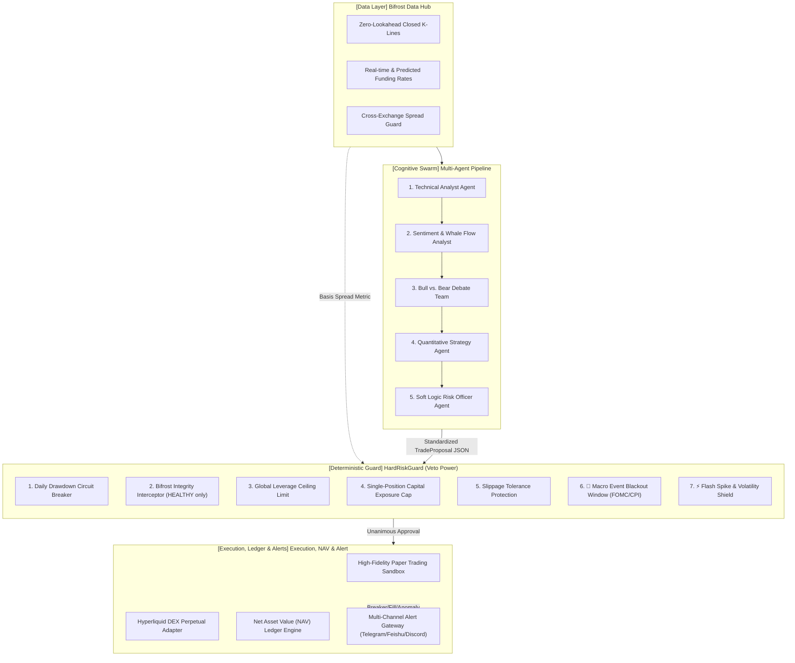

# Heimdall Trading Platform (`heimdall-trading`)

<div align="center">

```
  _    _ ______ _____ __  __ _____          _      _      
 | |  | |  ____|_   _|  \/  |  __ \   /\   | |    | |     
 | |__| | |__    | | | \  / | |  | | /  \  | |    | |     
 |  __  |  __|   | | | |\/| | |  | |/ /\ \ | |    | |     
 | |  | | |____ _| |_| |  | | |__| / ____ \| |____| |____ 
 |_|  |_|______|_____|_|  |_|_____/_/    \_\______|______|
```

**Production-Grade Multi-Agent AI Quant Trading & Asset Management Platform**  
*Dual-Track Safety: LLM Soft Reasoning + Deterministic Hard Risk Control*

[English](README.md) | [中文说明](README_ZH.md)

[](https://python.org)
[](https://fastapi.tiangolo.com)
[](LICENSE)
[](tests/)

</div>

---

## 📖 Table of Contents

- [1. System Mission & Core Value](#1-system-mission--core-value)
- [2. Dual-Track Safety Architecture](#2-dual-track-safety-architecture)
- [3. Multi-Agent Swarm Hierarchy](#3-multi-agent-swarm-hierarchy)
- [4. Unit Net Asset Value (NAV) Performance Engine](#4-unit-net-asset-value-nav-performance-engine)
- [5. Project Directory Structure](#5-project-directory-structure)
- [6. Quick Start & CLI Demo](#6-quick-start--cli-demo)
- [7. Web REST API Contract](#7-web-rest-api-contract)

---

## 1. System Mission & Core Value

In the three-tiered ecosystem of **"Data Substrate (`bifrost-onchain`) + Trading Brain (`heimdall-trading`) + Payment & Risk Gateway (`openagentpay.dev`)"**, `Heimdall` serves as the core quantitative trading brain and multi-bot asset management platform:

* **Complete Decoupling of Soft Reasoning and Hard Risk Control**: Large Language Models (LLMs) excel at qualitative macro analysis, multi-agent debate, and dynamic position sizing. However, **they are never given unrestricted execution authority**. A deterministic, sub-millisecond hard risk engine holds absolute veto power over every proposed order.
* **Bull vs. Bear Debate Mechanism (Inspired by TradingAgents / MIT & Tauric)**: Structured adversarial debates between a Bull Researcher and a Bear Researcher, arbitrated by a neutral Portfolio Moderator, eliminate up to 80% of LLM confirmation bias and false breakouts.
* **Net Asset Value (NAV) Accounting (Fund-Grade)**: Uses share-based allocation mechanics that neutralize the distortive effects of deposits and withdrawals on cumulative returns, Sharpe ratio, and Max Drawdown (MDD).
* **Native Integration with Bifrost Data Hub**: Direct zero-lookahead bias market ingestion, funding rate analytics, and cross-exchange price deviation guards (`HEALTHY`, `WARNING`, `DEGRADED`, `ISOLATED`).

---

## 2. Dual-Track Safety Architecture



---

## 3. Multi-Agent Swarm Hierarchy

| Agent Role | File Location | Specialization & Output |
| :--- | :--- | :--- |
| **Analyst Agent** | `heimdall/agents/analyst.py` | Computes EMA20/50, RSI14, ATR, and price channels to produce the *Market State Brief*. |
| **Sentiment & Whale** | `heimdall/agents/sentiment.py` | Tracks Fear & Greed index, exchange net inflow/outflow, and funding crowding to produce *Sentiment Brief*. |
| **Bull Researcher** | `heimdall/agents/debate.py` | Identifies catalysts, upside momentum, and invalidation stop levels with confidence scoring. |
| **Bear Researcher** | `heimdall/agents/debate.py` | Flags bull traps, resistance rejection, and funding rate drag with downside confidence scoring. |
| **Debate Moderator** | `heimdall/agents/debate.py` | Weighs asymmetric risk-reward, filters confirmation bias, and issues directional consensus (`LONG`, `SHORT`, or `NEUTRAL`). |
| **Strategy Agent** | `heimdall/agents/strategy.py` | Formulates entry price, strict stop loss, and target take-profit (minimum 1.6:1 risk-reward ratio). |
| **Risk Officer** | `heimdall/agents/risk_officer.py`| Soft-tier pre-check: validates mathematical consistency, directional integrity, and market regime alignment. |
| **Hard Risk Guard** | `heimdall/risk/guard.py` | Hard-tier deterministic check: enforces 7 iron rules (circuit breaker, leverage, macro blackout, flash spike). |
| **Alert Gateway** | `heimdall/alert/notifier.py` | 24/7 Multi-channel notifications: Telegram, Feishu (Lark), and Discord alerts for fills and circuit breakers. |

---

## 4. Unit Net Asset Value (NAV) Performance Engine

To prevent user deposits or withdrawals from corrupting real strategy return curves and drawdown metrics, Heimdall applies mutual-fund unit share accounting:

$$\text{NAV}_t = \frac{\text{Total Equity}_t}{\text{Total Shares}_t}$$

When a capital change $\Delta C$ occurs (deposit or withdrawal):

$$\Delta S = \frac{\Delta C}{\text{NAV}_t}, \quad \text{Total Shares}_{t^+} = \text{Total Shares}_t + \Delta S$$

$$\text{NAV}_{t^+} = \frac{\text{Total Equity}_t + \Delta C}{\text{Total Shares}_{t^+}} = \text{NAV}_t \quad (\text{Strictly smooth; zero artificial jumps})$$

---

## 5. Project Directory Structure

```text
heimdall-trading/
├── config/
│   └── default.yaml               # Default system settings (data source, DB, risk limits)
├── heimdall/
│   ├── accounting/                # Ledger & quantitative performance tracking
│   │   └── nav.py                 # NAV engine, Sharpe ratio, Max Drawdown calculator
│   ├── agents/                    # Multi-agent cognitive decision engine
│   │   ├── analyst.py             # Macro & technical indicators analyst
│   │   ├── debate.py              # Bull vs. Bear adversarial debate engine
│   │   ├── graph.py               # Pipeline orchestrator
│   │   ├── risk_officer.py        # Logic risk officer (soft pre-check)
│   │   ├── sentiment.py           # Sentiment & on-chain whale flow analyst
│   │   ├── state.py               # Shared decision context state definitions
│   │   └── strategy.py            # Quantitative proposal generation
│   ├── alert/                     # Real-time alert gateway
│   │   └── notifier.py            # Telegram, Feishu (Lark), Discord push notifications
│   ├── api/                       # REST API backend (FastAPI)
│   │   └── server.py              # Control plane endpoints
│   ├── bifrost/                   # Bifrost Data Hub client
│   │   └── client.py              # Read-only ingestion for zero-lookahead k-lines & guards
│   ├── data/                      # Alternative data & multi-source intelligence ingestion
│   │   └── sentiment_collector.py # Alternative.me Fear & Greed, news flash & derivatives
│   ├── database/                  # Data persistence layer (SQLite / PostgreSQL)
│   │   ├── db.py                  # Async connection pool & schema migration
│   │   └── repository.py          # Bot, decision, trade, and NAV repositories
│   ├── engine/                    # Orchestration core
│   │   ├── bot_manager.py         # Bot instance lifecycle management
│   │   └── scheduler.py           # 24/7 background daemon loop & watchdog
│   ├── execution/                 # Exchange execution adapters
│   │   ├── base.py                # Abstract execution contract
│   │   ├── hyperliquid.py         # Hyperliquid L1 DEX perpetuals adapter
│   │   └── paper.py               # In-memory realistic paper trading sandbox
│   ├── llm/                       # Unified LLM service
│   │   └── client.py              # Structured output inference & fallback
│   ├── models/                    # Pydantic schema specifications
│   │   └── schemas.py             # Standardized TradeProposal and RiskReviewResult
│   ├── risk/                      # Deterministic code-level hard guard
│   │   ├── flash_guard.py         # Flash spike & pin bar anomaly detector
│   │   ├── guard.py               # Absolute veto firewall (7 Iron Rules)
│   │   └── macro_guard.py         # Macro economic blackout calendar (FOMC/CPI)
│   ├── cli.py                     # Command-line interface entrypoint
│   └── config.py                  # Pydantic Settings configuration loader
├── migrations/                    # PostgreSQL 16 & TimescaleDB schema migrations
├── tests/                         # Full automated test suite (31 unit tests, 100% passing)
├── pyproject.toml                 # Packaging metadata & dependency specifications
└── requirements.txt               # Pinned dependencies
```

---

## 6. Quick Start & CLI Demo

### Run the End-to-End Multi-Agent Demo

Experience a live simulation cycle in the terminal (market perception $\to$ debate $\to$ proposal $\to$ risk guard $\to$ paper fill $\to$ NAV snapshot):

```bash
python3 -m heimdall.cli run-demo --symbol ETH --capital 10000
```

### Launch the Web Management Platform

```bash
python3 -m heimdall.cli serve --host 0.0.0.0 --port 8080
```

Access the interactive OpenAPI / Swagger console at `http://localhost:8080/docs`.

### Run the Automated Test Suite

```bash
python3 -m pytest tests/ -v
```

---

## 7. Web REST API Contract

| HTTP Method | Route | Description |
| :--- | :--- | :--- |
| `GET` | `/health` | System health check and liveness probe |
| `GET` | `/api/v1/bots` | List all active bot instances, status, and cumulative NAV |
| `POST`| `/api/v1/bots` | Register and deploy a new trading bot |
| `POST`| `/api/v1/bots/{bot_id}/start` | Start/resume a trading bot |
| `POST`| `/api/v1/bots/{bot_id}/stop` | Stop a trading bot |
| `POST`| `/api/v1/bots/{bot_id}/step` | Trigger a single evaluation cycle manually or via cron |
| `GET` | `/api/v1/bots/{bot_id}/nav` | Retrieve time-series NAV curve, MDD, and Sharpe ratio |
| `GET` | `/api/v1/bots/{bot_id}/decisions` | Query full chain-of-thought debate and proposal logs |
| `POST`| `/api/v1/emergency/kill` | **Global Emergency Kill Switch**: immediately halts bots and cancels all open orders |
