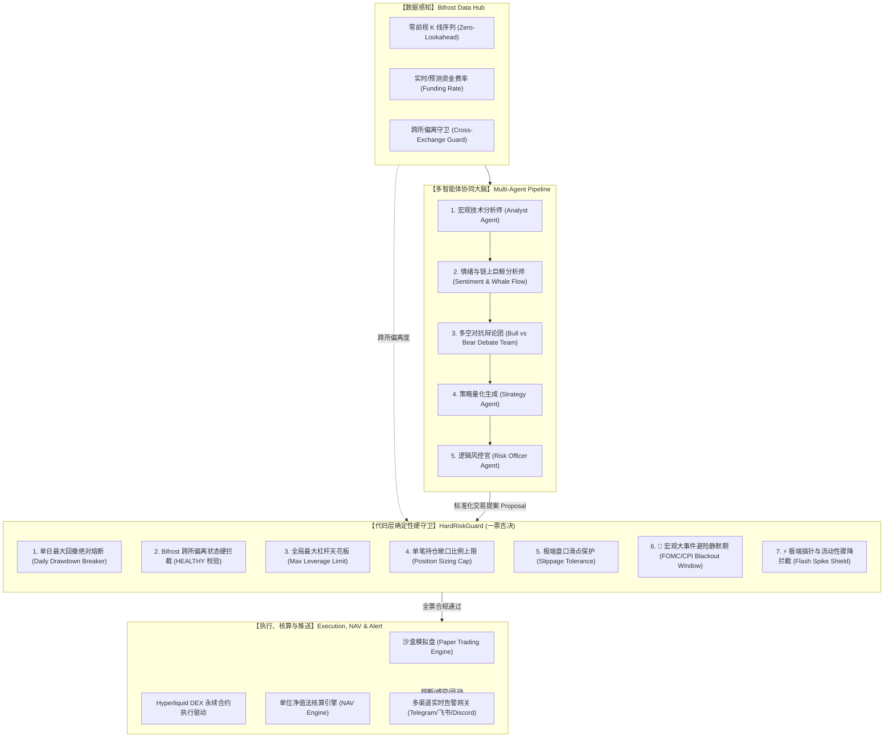

# Heimdall Trading Platform (`heimdall-trading`)

<div align="center">

```
  _    _ ______ _____ __  __ _____          _      _      
 | |  | |  ____|_   _|  \/  |  __ \   /\   | |    | |     
 | |__| | |__    | | | \  / | |  | | /  \  | |    | |     
 |  __  |  __|   | | | |\/| | |  | |/ /\ \ | |    | |     
 | |  | | |____ _| |_| |  | | |__| / ____ \| |____| |____ 
 |_|  |_|______|_____|_|  |_|_____/_/    \_\______|______|
```

**生产级多智能体协同 (Multi-Agent Swarm) AI 量化交易与资产管理平台**  
*Dual-Track Safety: LLM Soft Reasoning + Deterministic Hard Risk Control*

[English](README.md) | [中文说明](README_ZH.md)

[](https://python.org)
[](https://fastapi.tiangolo.com)
[](LICENSE)
[](tests/)

</div>

---

## 📖 目录

- [1. 系统定位与核心价值](#1-系统定位与核心价值)
- [2. 双轨制安全防线架构](#2-双轨制安全防线架构)
- [3. 多智能体分工协同体系](#3-多智能体分工协同体系)
- [4. 单位净值法 (NAV) 绩效核算](#4-单位净值法-nav-绩效核算)
- [5. 工程目录结构](#5-工程目录结构)
- [6. 快速开始与演练](#6-快速开始与演练)
- [7. Web REST API 契约](#7-web-rest-api-契约)

---

## 1. 系统定位与核心价值

在 **“Bifrost 数据底座 (`bifrost-onchain`) + Heimdall 交易大脑 (`heimdall-trading`) + 计费网关 (`openagentpay.dev`)”** 的三层架构中，`Heimdall` 承担核心交易执行与资产管理中枢职责：

* **软决策与硬风控彻底解耦**：大语言模型（LLM）擅长宏观研判、多空对抗辩论与动态头寸规划，但**绝不赋予其裸奔下单权**；系统由毫秒级纯代码确定性硬风控守护，拥有一票否决权。
* **借鉴 TradingAgents 的多空对抗激辩机制**：设立【多头研究员 (Bull Researcher)】与【空头研究员 (Bear Researcher)】对抗辩论，由【裁判 (Debate Moderator)】裁决，彻底杀死 80% 的模型确认偏差（Confirmation Bias）。
* **消除出入金干扰的单位净值法 (NAV)**：采用公募基金级份额分红折算机制，即使在实盘中频繁注资或提现，真实收益率、最大回撤 (MDD) 与夏普比率 (Sharpe Ratio) 依然平滑准确。
* **原生适配 Bifrost 零前视偏差金融底座**：无缝对接 Hyperliquid L1 DEX 及中心化交易所行情验真。

---

## 2. 双轨制安全防线架构



---

## 3. 多智能体分工协同体系

| 智能体角色 | 代码实现 | 专精领域与产出 |
| :--- | :--- | :--- |
| **Analyst Agent** | `heimdall/agents/analyst.py` | 提取 EMA20/50, RSI14, ATR, 通道极值，产出《技术面状态简报》|
| **Sentiment & Whale** | `heimdall/agents/sentiment.py` | 抓取恐慌贪婪指数、交易所大额净充提、多空持仓挤压度，产出《情绪与资金面研报》|
| **Bull Researcher** | `heimdall/agents/debate.py` | 结合技术与情绪面寻找催化剂与支撑，计算做多置信度与失效价格 |
| **Bear Researcher** | `heimdall/agents/debate.py` | 识别诱多陷阱、阻力位抛压与资金费损耗，计算做空置信度 |
| **Debate Moderator** | `heimdall/agents/debate.py` | 消除确认偏差，综合评判胜率赔率，裁决最终方向 (LONG / SHORT / NEUTRAL) |
| **Strategy Agent** | `heimdall/agents/strategy.py` | 基于凯利公式动态调节仓位，生成包含进场价、硬止损、止盈的提案 |
| **Risk Officer** | `heimdall/agents/risk_officer.py`| 软风控第一道防线：校验盈亏比 $\ge 1.6:1$、点位逻辑自洽性 |
| **Hard Risk Guard** | `heimdall/risk/guard.py` | 纯代码第二道防线：守卫七大铁律（回撤熔断、偏离拦截、宏观静默期、插针防御） |
| **Alert Gateway** | `heimdall/alert/notifier.py` | 全天候多渠道通知：支持 Telegram、飞书、Discord 熔断与成交实时推送 |

---

## 4. 单位净值法 (NAV) 绩效核算

为解决账户追加投资 (Deposit) 或提取利润 (Withdrawal) 导致收益率与回撤失真的问题，系统采用份额折算模型：

$$\text{NAV}_t = \frac{\text{Total Equity}_t}{\text{Total Shares}_t}$$

当发生充提币 $\Delta C$ 时：

$$\Delta S = \frac{\Delta C}{\text{NAV}_t}, \quad \text{Total Shares}_{t^+} = \text{Total Shares}_t + \Delta S$$

$$\text{NAV}_{t^+} = \frac{\text{Total Equity}_t + \Delta C}{\text{Total Shares}_{t^+}} = \text{NAV}_t \quad (\text{净值平滑，不产生阶跃跳空})$$

---

## 5. 工程目录结构

```text
heimdall-trading/
├── config/
│   └── default.yaml               # 系统默认配置 (数据源、数据库、风控阈值)
├── heimdall/
│   ├── accounting/                # 资产核算与量化绩效模块
│   │   └── nav.py                 # 单位净值 (NAV) 与夏普/回撤计算引擎
│   ├── agents/                    # 多智能体协同决策大脑
│   │   ├── analyst.py             # 宏观技术分析师
│   │   ├── debate.py              # Tauric/MIT 风格多空对抗辩论团
│   │   ├── graph.py               # 多智能体状态流水线编排器
│   │   ├── risk_officer.py        # 逻辑风控官
│   │   ├── sentiment.py           # 情绪与链上巨鲸异动分析师
│   │   ├── state.py               # 决策上下文状态流定义
│   │   └── strategy.py            # 策略生成与头寸管理
│   ├── alert/                     # 全天候告警网关
│   │   └── notifier.py            # Telegram, 飞书, Discord 毫秒级推送
│   ├── api/                       # Web REST API 服务端
│   │   └── server.py              # FastAPI 控制台中台路由
│   ├── bifrost/                   # Bifrost Data Hub 客户端
│   │   └── client.py              # 零前视 K 线与跨所状态只读感知
│   ├── data/                      # 替代数据与多源情绪情报采集器
│   │   └── sentiment_collector.py # Alternative.me 恐慌指数、行业快讯与衍生品聚合
│   ├── database/                  # 数据持久化存储层 (SQLite / PostgreSQL)
│   │   ├── db.py                  # 连接池与自动建表迁移
│   │   └── repository.py          # 机器人/决策/成交/净值 CRUD 仓储
│   ├── engine/                    # 调度中台
│   │   ├── bot_manager.py         # 交易机器人实例与生命周期调度
│   │   └── scheduler.py           # 24/7 守护进程调度器与容错看门狗
│   ├── execution/                 # 交易所执行适配驱动
│   │   ├── base.py                # 执行器标准接口抽象
│   │   ├── hyperliquid.py         # Hyperliquid DEX 永续合约适配器
│   │   └── paper.py               # 高精度沙盒模拟撮合引擎
│   ├── llm/                       # 大语言模型统一服务
│   │   └── client.py              # 结构化输出推理与确定性本地降级兜底
│   ├── models/                    # Pydantic 契约模型与枚举
│   │   └── schemas.py             # 交易提案与风控结果 Schema
│   ├── risk/                      # 确定性硬风控模块
│   │   ├── flash_guard.py         # 极端插针与流动性骤降检测器
│   │   ├── guard.py               # 具有一票否决权的代码层防火墙 (七大铁律)
│   │   └── macro_guard.py         # 宏观重大事件避险日历 (FOMC / CPI 静默期)
│   ├── cli.py                     # 终端交互命令行入口
│   └── config.py                  # Pydantic Settings 配置解析
├── migrations/                    # PostgreSQL 16 / TimescaleDB 建表脚本
├── tests/                         # 单元测试集 (31 个测试用例，100% 通过)
├── pyproject.toml                 # 项目构建元数据与依赖定义
└── requirements.txt               # 依赖列表
```

---

## 6. 快速开始与演练

### 运行全链路多智能体演示

使用内置的 CLI 工具，在终端直观体验一次完整的端到端决策、对抗辩论与沙盒成交：

```bash
python3 -m heimdall.cli run-demo --symbol ETH --capital 10000
```

### 启动 Web 控制台中台服务

```bash
python3 -m heimdall.cli serve --host 0.0.0.0 --port 8080
```

访问 `http://localhost:8080/docs` 查看交互式 Swagger API 文档。

### 运行自动化单元测试

```bash
python3 -m pytest tests/ -v
```

---

## 7. Web REST API 契约

| 方法 | 路径 | 功能说明 |
| :--- | :--- | :--- |
| `GET` | `/health` | 系统健康检查与存活探针 |
| `GET` | `/api/v1/bots` | 查询全平台所有机器人的运行状态与累计净值 |
| `POST`| `/api/v1/bots` | 注册创建新交易机器人 |
| `POST`| `/api/v1/bots/{bot_id}/start` | 启动指定交易机器人 |
| `POST`| `/api/v1/bots/{bot_id}/stop` | 停止指定交易机器人 |
| `POST`| `/api/v1/bots/{bot_id}/step` | 手动触发一轮多智能体决策与撮合循环 |
| `GET` | `/api/v1/bots/{bot_id}/nav` | 获取机器人的时序单位净值走势曲线与夏普指标 |
| `GET` | `/api/v1/bots/{bot_id}/decisions` | 查验模型完整思维链 (Chain-of-Thought) 审计日志 |
| `POST`| `/api/v1/emergency/kill` | **全局紧急急停**：一键撤单并锁死所有机器人 |
