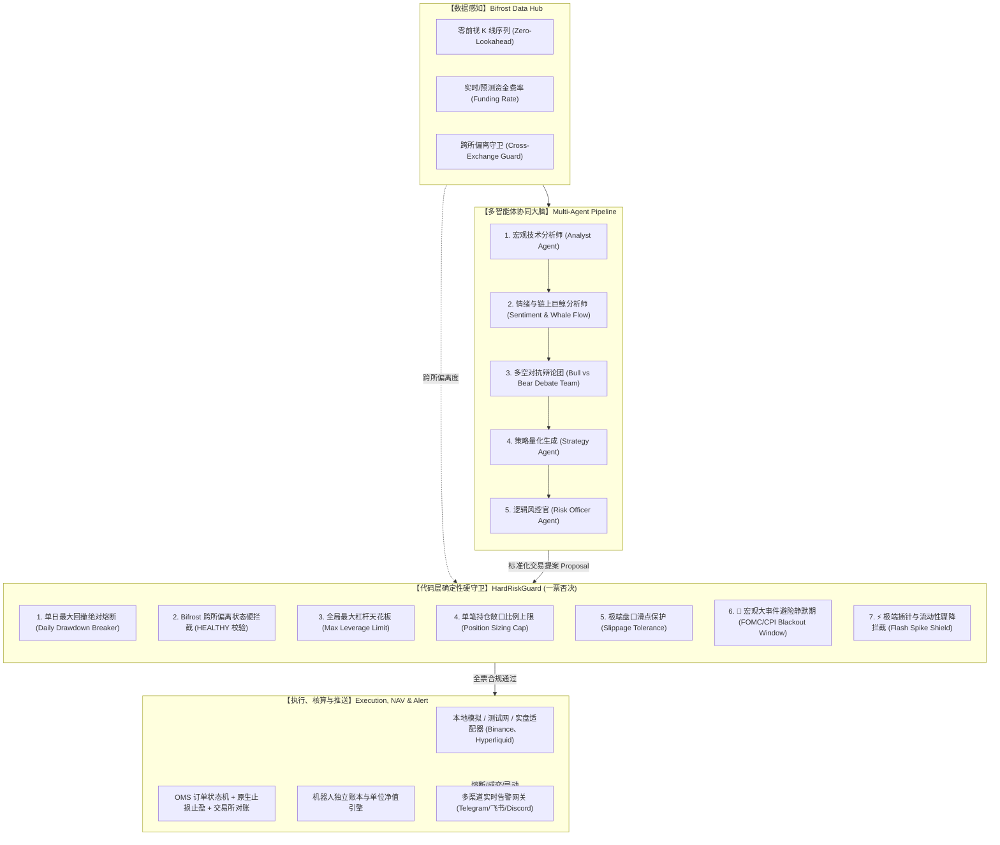

# Heimdall Trading Platform (`heimdall-trading`)

<div align="center">

```
  _    _ ______ _____ __  __ _____          _      _      
 | |  | |  ____|_   _|  \/  |  __ \   /\   | |    | |     
 | |__| | |__    | | | \  / | |  | | /  \  | |    | |     
 |  __  |  __|   | | | |\/| | |  | |/ /\ \ | |    | |     
 | |  | | |____ _| |_| |  | | |__| / ____ \| |____| |____ 
 |_|  |_|______|_____|_|  |_|_____/_/    \_\______|______|
```

**生产级多智能体协同 (Multi-Agent Swarm) AI 量化交易与资产管理平台**  
*Dual-Track Safety: LLM Soft Reasoning + Deterministic Hard Risk Control*

[English](README.md) | [中文说明](README_ZH.md)

📘 **[产品说明：功能介绍与界面截图](docs/PRODUCT.md)**

[](https://python.org)
[](https://fastapi.tiangolo.com)
[](LICENSE)
[](tests/)

</div>

---

## 📖 目录

- [1. 系统定位与核心价值](#1-系统定位与核心价值)
- [2. 双轨制安全防线架构](#2-双轨制安全防线架构)
- [3. 多智能体分工协同体系](#3-多智能体分工协同体系)
- [4. 单位净值法 (NAV) 绩效核算](#4-单位净值法-nav-绩效核算)
- [5. 工程目录结构](#5-工程目录结构)
- [6. 快速开始与演练](#6-快速开始与演练)
- [7. Web REST API 契约](#7-web-rest-api-契约)
- [产品说明（功能与界面截图）](docs/PRODUCT.md)

---

## 1. 系统定位与核心价值

在 **“Bifrost 数据底座 (`bifrost-onchain`) + Heimdall 交易大脑 (`heimdall-trading`) + 计费网关 (`openagentpay.dev`)”** 的三层架构中，`Heimdall` 承担核心交易执行与资产管理中枢职责：

* **软决策与硬风控彻底解耦**：大语言模型（LLM）擅长宏观研判、多空对抗辩论与动态头寸规划，但**绝不赋予其裸奔下单权**；系统由毫秒级纯代码确定性硬风控守护，拥有一票否决权。
* **借鉴 TradingAgents 的多空对抗激辩机制**：设立【多头研究员 (Bull Researcher)】与【空头研究员 (Bear Researcher)】对抗辩论，由【裁判 (Debate Moderator)】裁决，彻底杀死 80% 的模型确认偏差（Confirmation Bias）。
* **消除出入金干扰的单位净值法 (NAV)**：采用公募基金级份额分红折算机制，即使在实盘中频繁注资或提现，真实收益率、最大回撤 (MDD) 与夏普比率 (Sharpe Ratio) 依然平滑准确。
* **原生适配 Bifrost 零前视偏差金融底座**：无缝对接 Hyperliquid L1 DEX 及中心化交易所行情验真。

---

## 2. 双轨制安全防线架构



---

## 3. 多智能体分工协同体系

| 智能体角色 | 代码实现 | 专精领域与产出 |
| :--- | :--- | :--- |
| **Analyst Agent** | `heimdall/agents/analyst.py` | 提取 EMA20/50, RSI14, ATR, 通道极值，产出《技术面状态简报》|
| **Sentiment & Whale** | `heimdall/agents/sentiment.py` | 抓取恐慌贪婪指数、交易所大额净充提、多空持仓挤压度，产出《情绪与资金面研报》|
| **Bull Researcher** | `heimdall/agents/debate.py` | 结合技术与情绪面寻找催化剂与支撑，计算做多置信度与失效价格 |
| **Bear Researcher** | `heimdall/agents/debate.py` | 识别诱多陷阱、阻力位抛压与资金费损耗，计算做空置信度 |
| **Debate Moderator** | `heimdall/agents/debate.py` | 消除确认偏差，综合评判胜率赔率，裁决最终方向 (LONG / SHORT / NEUTRAL) |
| **Strategy Agent** | `heimdall/agents/strategy.py` | 基于凯利公式动态调节仓位，生成包含进场价、硬止损、止盈的提案 |
| **Risk Officer** | `heimdall/agents/risk_officer.py`| 软风控第一道防线：校验盈亏比 $\ge 1.6:1$、点位逻辑自洽性 |
| **Hard Risk Guard** | `heimdall/risk/guard.py` | 纯代码第二道防线：守卫七大铁律（回撤熔断、偏离拦截、宏观静默期、插针防御） |
| **Alert Gateway** | `heimdall/alert/notifier.py` | 全天候多渠道通知：支持 Telegram、飞书、Discord 熔断与成交实时推送 |

---

## 4. 单位净值法 (NAV) 绩效核算

为解决账户追加投资 (Deposit) 或提取利润 (Withdrawal) 导致收益率与回撤失真的问题，系统采用份额折算模型：

$$\text{NAV}_t = \frac{\text{Total Equity}_t}{\text{Total Shares}_t}$$

当发生充提币 $\Delta C$ 时：

$$\Delta S = \frac{\Delta C}{\text{NAV}_t}, \quad \text{Total Shares}_{t^+} = \text{Total Shares}_t + \Delta S$$

$$\text{NAV}_{t^+} = \frac{\text{Total Equity}_t + \Delta C}{\text{Total Shares}_{t^+}} = \text{NAV}_t \quad (\text{净值平滑，不产生阶跃跳空})$$

---

## 5. 工程目录结构

```text
├── config/
│   ├── default.yaml                   # 系统默认配置（数据源、数据库、风控阈值）
│   └── macro_events.yaml              # 宏观事件日历（FOMC / CPI），供静默期规则使用
├── heimdall/
│   ├── accounting/                    # 资产核算
│   │   ├── ledger.py                  # 机器人独立账本（测试网 / 实盘按自身成交记账）
│   │   └── nav.py                     # 单位净值、日内回撤、夏普 / 卡玛
│   ├── agents/                        # 多智能体决策流水线
│   │   ├── analyst.py · sentiment.py  # 技术面与情绪分析
│   │   ├── debate.py                  # 多空研究员与辩论裁判
│   │   ├── graph.py                   # 流水线编排（前置门控、检查点续跑）
│   │   ├── strategy.py · risk_officer.py  # 生成交易提案与逻辑风控
│   │   └── state.py · tools.py · governance.py  # 共享状态、只读取证工具、预算
│   ├── alert/
│   │   ├── notifier.py                # Telegram / 飞书 / Discord 告警
│   │   └── heartbeat.py               # 外部死信心跳
│   ├── api/
│   │   ├── server.py                  # FastAPI 应用装配（生命周期、CORS、挂载路由）
│   │   ├── runtime.py                 # 进程级单例：BotManager、单实例运行锁
│   │   ├── routes/                    # 业务接口：机器人管理 / 控制 / 绩效审计 / 模拟下单 / 风控急停 / 行情 / 推流
│   │   ├── workbench_router.py        # OMS、对账、影子报告、回测接口
│   │   └── websocket.py               # 实时事件推送
│   ├── auth/                          # 钱包登录（SIWE）与 AES-256-GCM 密钥金库
│   ├── backtest/                      # 零前视回测与 Walk-Forward 验证
│   ├── bifrost/ · data/               # 多源行情（Binance → OKX → Hyperliquid）与情绪数据
│   ├── database/                      # SQLite / PostgreSQL 持久化与仓储
│   ├── engine/
│   │   ├── bot_manager.py             # TradingBotInstance（单个机器人入口）与 BotManager
│   │   ├── bot_services/              # 单个机器人：决策周期、提案复审、下单、账本、对账、止损保护、规格、标记价格
│   │   ├── fleet/                     # 平台级：启停与急停、同账户冲突、资金划拨、重启恢复、首次引导、凭证热重载
│   │   ├── scheduler.py               # 后台决策与对账循环
│   │   └── shadow.py                  # 影子模式运行报告与晋级门控
│   ├── execution/
│   │   ├── factory.py                 # 按 交易所 × 市场 × 运行模式 选择适配器
│   │   ├── binance.py · hyperliquid.py  # 交易所适配器（币安条件单走 Algo 接口）
│   │   ├── local_sim.py               # 本地模拟撮合（LOCAL_SIM）
│   │   ├── oms.py                     # 订单状态机、原生止损止盈、查单恢复
│   │   ├── reconciler.py              # 交易所对账
│   │   └── precision.py               # Decimal 价格 / 数量精度对齐
│   ├── factors/                       # 因子引擎
│   ├── strategies/                    # 策略路由 + 趋势 / 网格 / 资金费套利 / 多空辩论
│   ├── risk/                          # 硬风控（七大铁律）、宏观日历、插针检测、组合敞口锁
│   ├── llm/ · models/                 # 大模型服务与 Pydantic 数据模型
│   ├── utils/                         # CORS、日志脱敏、部署安全预检、单实例锁
│   └── cli.py · config.py             # 命令行入口与配置加载
├── migrations/                        # PostgreSQL 建表脚本
├── scripts/                           # 币安合约测试网验证脚本
├── tests/                             # pytest 测试集（单元、集成，黄金评测集在 tests/evals/）
├── web/                               # React / Vite 前端工作台
├── pyproject.toml                     # 项目构建元数据与依赖定义（依赖唯一事实来源）
├── requirements.txt                   # 运行时依赖（与 pyproject 保持一致，Docker 使用）
└── requirements-dev.txt               # 开发 / 测试依赖
```

---

## 6. 快速开始与演练

### 运行全链路多智能体演示

使用内置的 CLI 工具，在终端直观体验一次完整的端到端决策、对抗辩论与沙盒成交：

```bash
python3 -m heimdall.cli run-demo --symbol ETH --capital 10000
```

### 启动 Web 控制台中台服务

```bash
python3 -m heimdall.cli serve --host 0.0.0.0 --port 8000
```

访问 `http://localhost:8000/docs` 查看交互式 Swagger API 文档。

### Docker 部署与端口

```bash
./deploy.sh up      # 或 docker compose up -d
```

| 容器 | 服务 | 容器内端口 | 说明 |
| :--- | :--- | :---: | :--- |
| `heimdall-web` | Nginx + 前端静态资源 | 80 | 内网入口（由反代转发）；`/api/`、`/v1/`、`/ws/`、`/health` 反代到 `backend:8000` |
| `heimdall-backend` | FastAPI（uvicorn，`--workers 1`） | 8000 | 仅在 Compose 内网 `heimdall-network` 中访问 |
| `heimdall-postgres` | PostgreSQL 16 | 5432 | 仅供后端连接 |

- 三个容器都不映射宿主机端口。对外访问需让反向代理（或网关）容器加入 `heimdall-network`，转发到 `heimdall-web:80`，并把对外域名加入 `HEIMDALL_CORS_ORIGINS`。
- 部署后健康检查（经前端 Nginx 转发到后端）：`docker exec heimdall-backend python -c "import urllib.request;print(urllib.request.urlopen('http://web/health').read().decode())"`。
- 本地开发：后端 `heimdall.cli serve` 监听 8000，前端 `cd web && npm run dev` 监听 3000，并把 `/api`、`/ws` 代理到 8000。
- `config/default.yaml` 中的 Bifrost 地址 `localhost:8080` 为预留项（Bifrost 尚未接入），与上述端口无关。

### 运行自动化单元测试

```bash
python3 -m pytest tests/ -v
```

---

## 7. Web REST API 契约

| 方法 | 路径 | 功能说明 |
| :--- | :--- | :--- |
| `GET` | `/health` | 系统健康检查与存活探针 |
| `GET` | `/api/v1/bots` | 查询全平台所有机器人的运行状态与累计净值 |
| `POST`| `/api/v1/bots` | 注册创建新交易机器人 |
| `POST`| `/api/v1/bots/{bot_id}/start` | 启动指定交易机器人 |
| `POST`| `/api/v1/bots/{bot_id}/stop` | 停止指定交易机器人 |
| `POST`| `/api/v1/bots/{bot_id}/step` | 手动触发一轮多智能体决策与撮合循环 |
| `GET` | `/api/v1/bots/{bot_id}/nav` | 获取机器人的时序单位净值走势曲线与夏普指标 |
| `GET` | `/api/v1/bots/{bot_id}/decisions` | 查验模型完整思维链 (Chain-of-Thought) 审计日志 |
| `POST`| `/api/v1/bots/{bot_id}/orders/paper` | 手动下单（仅限本地模拟机器人，按跨所实时中位价成交） |
| `GET` | `/api/v1/bots/{bot_id}/oms/orders` | 查询 OMS 订单与原生保护单 |
| `POST`| `/api/v1/bots/{bot_id}/reconcile` | 立即执行一次交易所对账（可选对账一致后恢复运行） |
| `GET` | `/api/v1/bots/{bot_id}/shadow-report` | 影子模式运行报告与 7 天晋级门控 |
| `GET` | `/api/v1/system/live-readiness` | 实盘就绪检查 |
| `POST`| `/api/v1/emergency/kill` | **全局紧急急停**：一键撤单并锁死所有机器人 |

> 同一个数据库只能运行**一个**后端进程（`--workers 1`）。第二个进程启动时会被单实例锁拒绝（`HEIMDALL_INSTANCE_LOCK`）。
