# Heimdall 产品说明

> **多智能体 AI 量化交易与资产管理平台**
> 大模型负责研判与辩论，代码负责风控与执行；每一轮决策都可追溯、可审计。

| 项目 | 内容 |
| :--- | :--- |
| 文档版本 | v1.0（2026-11-23） |
| 适用分支 | `fix/audit-2026-11` 及之后 |
| 截图环境 | 云端部署实例，机器人 `bot_4350`（BNB · 币安 U 本位合约 · 测试网），截图时间 2026-11-23 10:08–10:11（新加坡时间） |
| 相关文档 | [README_ZH.md](../README_ZH.md)（技术架构、目录结构、API）、[README.md](../README.md)（英文） |

> 截图中的价格、收益率等数字都来自测试网的真实运行数据，只用来说明界面，不代表策略的收益承诺。

---

## 目录

- [1. 产品概述](#1-产品概述)
- [2. 一轮决策是怎样完成的](#2-一轮决策是怎样完成的)
- [3. 界面总览](#3-界面总览)
- [4. 功能模块详解](#4-功能模块详解)
  - [4.1 对弈大厅](#41-对弈大厅)
  - [4.2 智能体详情](#42-智能体详情)
  - [4.3 蜂群编排](#43-蜂群编排)
  - [4.4 回测实验室](#44-回测实验室)
  - [4.5 情绪与链上情报](#45-情绪与链上情报)
  - [4.6 净值与对账中心](#46-净值与对账中心)
  - [4.7 风控雷达与对账守卫](#47-风控雷达与对账守卫)
  - [4.8 决策审计](#48-决策审计)
  - [4.9 思维链与控制台](#49-思维链与控制台)
  - [4.10 钱包登录与密钥金库](#410-钱包登录与密钥金库)
  - [4.11 新建机器人与资金配比](#411-新建机器人与资金配比)
- [5. 运行模式与安全约定](#5-运行模式与安全约定)
- [6. 部署与访问](#6-部署与访问)
- [7. 当前限制](#7-当前限制)
- [附录 A：智能体角色一览](#附录-a智能体角色一览)
- [附录 B：截图索引](#附录-b截图索引)

---

## 1. 产品概述

### 1.1 Heimdall 是什么

Heimdall 是一个面向加密资产的多智能体量化交易平台。用户在网页工作台上创建"策略机器人"，每个机器人绑定一个交易标的、一家交易所、一种市场（现货或 U 本位合约）和一种运行模式（本地模拟、测试网或实盘）。机器人按固定周期（默认 15 分钟）自动完成一轮"研判 → 辩论 → 生成提案 → 风控校验 → 下单 → 记账"，全过程在界面上实时展示，并写入数据库供事后审计。

### 1.2 核心价值

| 价值 | 说明 |
| :--- | :--- |
| **双轨制安全** | 大模型（LLM）只负责研判、辩论和提出交易提案，**没有直接下单的权限**。所有提案都要经过纯代码实现的硬风控（七条规则），任何一条不通过即否决。 |
| **多空对抗辩论** | 设立多头研究员与空头研究员各自立论，由辩论裁判综合双方证据给出最终方向（做多 / 做空 / 观望），减少单一模型的确认偏差。 |
| **单位净值核算** | 采用基金式的份额折算：追加或减少资金时按当前净值增减份额，净值曲线不会因为出入金出现跳变，收益率、最大回撤、夏普比率始终可比。 |
| **全链路可审计** | 每一轮决策的分析结论、辩论原文、裁决理由、风控结果、各步骤耗时都会被记录，可以在审计页逐轮回看。 |
| **多机器人管理** | 一个平台同时运行多个机器人，统一启停、统一调资、一键急停；同一交易账户的冲突会被自动拦截。 |
| **零前视回测** | 回测严格按"t 时刻决策、t+1 时刻撮合"执行，并且与实盘复用同一套因子、策略路由、硬风控和净值引擎，避免回测与实盘口径不一致。 |

### 1.3 适合谁

- 想用大模型辅助交易决策、但不愿意把下单权交给模型的个人量化交易者；
- 需要同时管理多个策略、并看清每个策略真实净值表现的小型团队；
- 需要完整决策留痕、方便复盘和合规审查的使用场景。

---

## 2. 一轮决策是怎样完成的

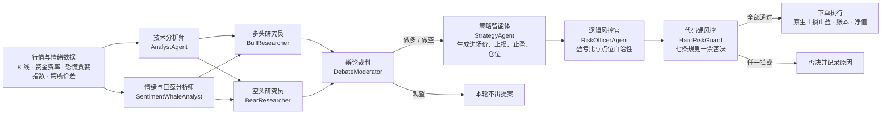

1. **数据感知**：拉取多交易所 K 线、资金费率、多空比、恐慌贪婪指数、跨所价差等数据。
2. **分析**：技术分析师判断市场状态（趋势上行 / 趋势下行 / 区间震荡）和关键支撑阻力；情绪分析师给出综合情绪分。
3. **辩论**：多头和空头研究员分别给出方向、目标价、失效价和置信度；辩论裁判综合双方给出裁决。
4. **提案**：裁决为做多或做空时，策略智能体按仓位规则生成交易提案；裁决为观望时本轮结束，不下单。
5. **风控**：逻辑风控官先做软校验（例如盈亏比不低于 1.6:1），再由代码硬风控逐条检查七条规则。
6. **执行与记账**：通过后按交易所规格对齐价格与数量下单，并挂原生止损止盈；成交写入机器人独立账本并更新单位净值。

每一步的结论和耗时都会推送到界面右侧的"思维链"面板，并写入审计记录。

---

## 3. 界面总览

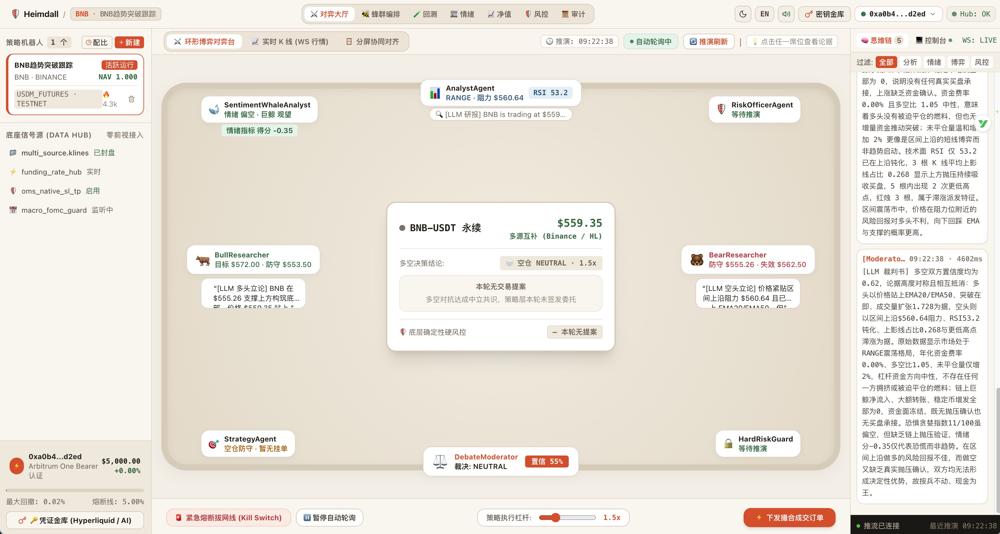

工作台分为五个区域：

| 区域 | 位置 | 内容 |
| :--- | :--- | :--- |
| **顶部导航** | 最上方 | 七个主视图：对弈大厅、蜂群编排、回测、情绪、净值、风控、审计；右侧是深色模式、中英文切换、声音提醒、密钥金库、钱包地址和数据底座连接状态（`Hub: OK`）。 |
| **策略机器人列表** | 左上 | 当前钱包下的机器人，显示名称、标的、交易所、运行状态、单位净值、市场与运行模式；可新建机器人、打开资金配比。演示机器人带"演示"徽章。 |
| **数据源状态** | 左中 | 底座信号源：多源 K 线、资金费率、原生止损止盈、宏观 FOMC 静默守卫等是否在线。 |
| **账户卡片** | 左下 | 当前钱包地址、认证方式、账户资金、当日盈亏、最大回撤与熔断线；底部是凭证金库入口。 |
| **右侧面板** | 右侧 | "思维链"实时显示每个智能体的推演原文，可按分析 / 情绪 / 博弈 / 风控过滤；"控制台"支持命令行操作。底部显示推流连接状态和最近一次推演时间。 |

---

## 4. 功能模块详解

### 4.1 对弈大厅

对弈大厅是默认首页，用"环形博弈台"把一轮决策中的各个智能体放在同一张桌上展示（见第 3 节截图）。

- **中央卡片**：标的与最新价格（多源互补，例如 Binance / Hyperliquid）、本轮多空决策结论（如"空仓 NEUTRAL · 1.5x"）、是否生成交易提案、底层硬风控状态。
- **周围席位**：技术分析师、情绪与巨鲸分析师、多头研究员、空头研究员、策略智能体、逻辑风控官、硬风控守卫、辩论裁判。每个席位显示该角色本轮的核心结论，例如技术分析师显示"RANGE · 阻力 $560.64，RSI 53.2"，裁判显示"裁决：NEUTRAL，置信 55%"。
- **顶部切换**：环形博弈对弈台 / 实时 K 线（WebSocket 行情）/ 分屏协同对齐。
- **右上操作**：显示最近推演时间、自动轮询状态，"推演刷新"可手动触发一轮推演。
- **底部操作栏**：
  - **紧急熔断拔网线（Kill Switch）**：一键锁定全部机器人并撤销在途订单；
  - **暂停自动轮询**：暂停对弈大厅页面的自动刷新，不影响后台机器人的定时调度；
  - **策略执行杠杆**：拖动后在中央卡片和提案中显示对应倍数（目前只用于页面展示，见第 7 节）；
  - **下发撮合成交订单**：立即为当前机器人跑一轮完整决策；如果本轮生成了提案并通过风控，就按机器人的运行模式执行。

### 4.2 智能体详情

点击博弈台上任意一个席位，会弹出该智能体的详情卡片。

<table>
  <tr>
    <td align="center">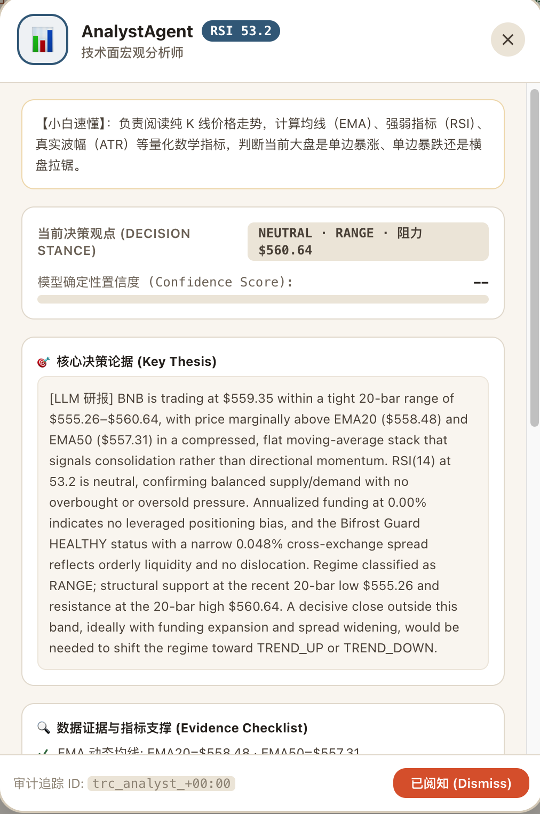<br/>技术分析师 AnalystAgent</td>
    <td align="center">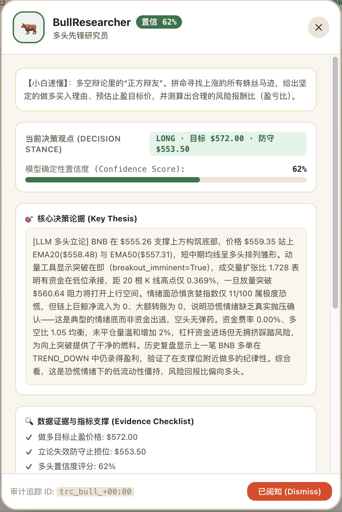<br/>多头研究员 BullResearcher</td>
    <td align="center">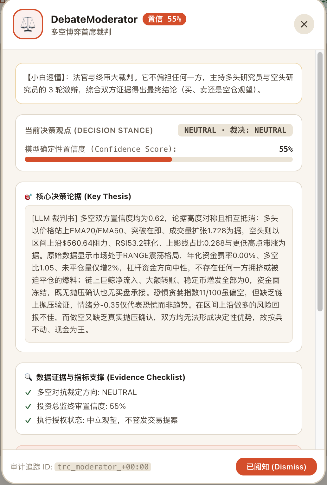<br/>辩论裁判 DebateModerator</td>
  </tr>
</table>

每张卡片包含相同的结构，方便对照阅读：

| 区块 | 内容 |
| :--- | :--- |
| **小白速懂** | 用一句话说明这个角色负责什么，例如裁判"不偏袒任何一方，主持多空 3 轮激辩，综合双方证据得出最终结论"。 |
| **当前决策观点** | 本轮立场，例如多头研究员"LONG · 目标 $572.00 · 防守 $553.50"，技术分析师"NEUTRAL · RANGE · 阻力 $560.64"。 |
| **置信度** | 模型对本轮观点的确定性评分（技术分析师不给置信度时显示"--"）。 |
| **核心决策论据** | 大模型给出的完整论述原文，包含引用的指标数值（EMA、RSI、成交量、资金费率、恐慌贪婪指数、链上巨鲸流向等）。 |
| **数据证据清单** | 把论据中的关键数值单独列出，例如止盈价、止损价、置信度、裁决方向、执行授权状态。 |
| **审计追踪 ID** | 对应审计记录的编号，可在审计页查找同一轮决策。 |

截图中的例子说明了辩论机制如何工作：多头研究员以"价格站上 EMA20/EMA50、突破在即"给出 62% 的做多置信度，空头研究员以"区间上沿阻力、RSI 钝化、上影线抛压"给出对等的做空理由；裁判判断双方论据相互抵消、资金面冻结，最终裁决观望，本轮不签发交易提案。

### 4.3 蜂群编排

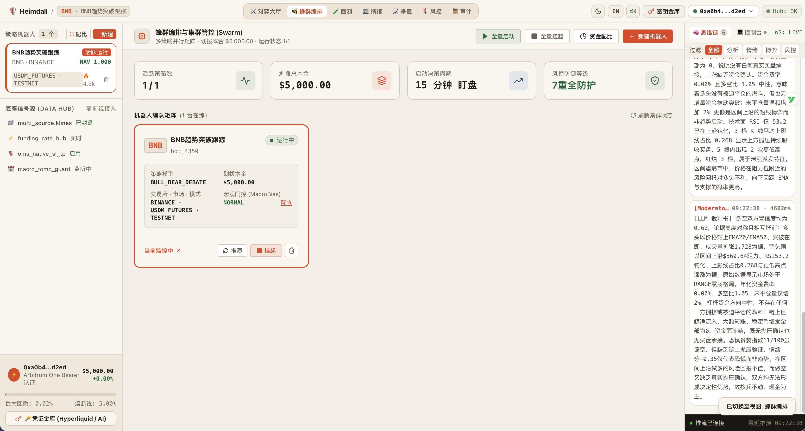

蜂群编排页用于管理平台上的全部机器人。

- **顶部指标**：活跃策略数（如 1/1）、划拨总本金（如 $5,000.00）、决策周期（如"15 分钟盯盘"）、风控防御等级（"7 重全防护"）。
- **批量操作**：全量启动、全量挂起、资金配比、新建机器人。
- **机器人卡片**：每个机器人显示名称与 ID、运行状态、策略模型（如 `BULL_BEAR_DEBATE`）、划拨本金、交易所 · 市场 · 模式（如 `BINANCE · USDM_FUTURES · TESTNET`）、宏观门控状态（如 `NORMAL`）；卡片底部可"推演"（手动跑一轮）、"挂起"（停止调度）、删除，或点击"当前监控中"切换到该机器人的详情视图。

### 4.4 回测实验室

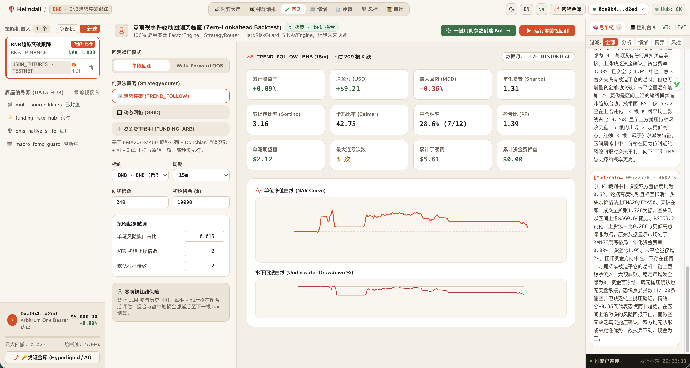

回测实验室用来在历史数据上验证纯算法策略，并把满意的参数一键变成机器人。

- **两种验证模式**：单段回测；Walk-Forward 样本外验证（OOS），用于检查参数是否过拟合。
- **可回测的策略**：趋势突破（`TREND_FOLLOW`，EMA20/EMA50 顺势排列 + Donchian 通道突破 + ATR 动态止损和追踪止盈）、动态网格（`GRID`）、资金费率套利（`FUNDING_ARB`）。
- **参数**：标的、K 线周期、K 线根数、初始资金，以及单笔风险敞口占比、ATR 初始止损倍数、默认杠杆等策略超参。
- **结果指标**：累计收益率、净盈亏、最大回撤、年化夏普、索提诺比率、卡玛比率、平仓胜率、盈亏比、单笔期望值、最大连亏次数、累计手续费、累计资金费损益；并绘制单位净值曲线和水下回撤曲线。
- **零前视红线**：禁止大模型参与历史回测；每根 K 线收盘后才评估信号，撮合与盘中触发统一延后到下一根 K 线。
- **一键用此参数创建 Bot**：把当前回测参数直接带入新建机器人表单。

### 4.5 情绪与链上情报

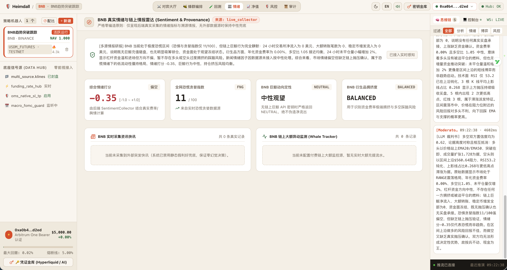

情绪页展示情绪分析师使用的原始数据和综合判断，遵循"严格零编造"原则：只展示后端真实采集到的数据，没有接入的数据源保持中性，不伪造数值。

- **多源情报研报**：一段自然语言总结，例如"市场处于极度恐慌区间，但链上巨鲸行为完全静默，属于恐慌情绪下的低流动性僵持"。
- **四个指标卡**：综合情绪打分（-1.0 到 +1.0）、全网恐慌贪婪指数（0–100）、巨鲸动向定性、衍生品拥挤度（用于识别资金费率极端拥挤和多空踩踏风险）。
- **实时资讯快讯**与**链上大额异动监测**：接入对应数据源后展示真实记录；未接入时明确提示"暂无"，并说明系统已禁用静态假利好兜底。

### 4.6 净值与对账中心

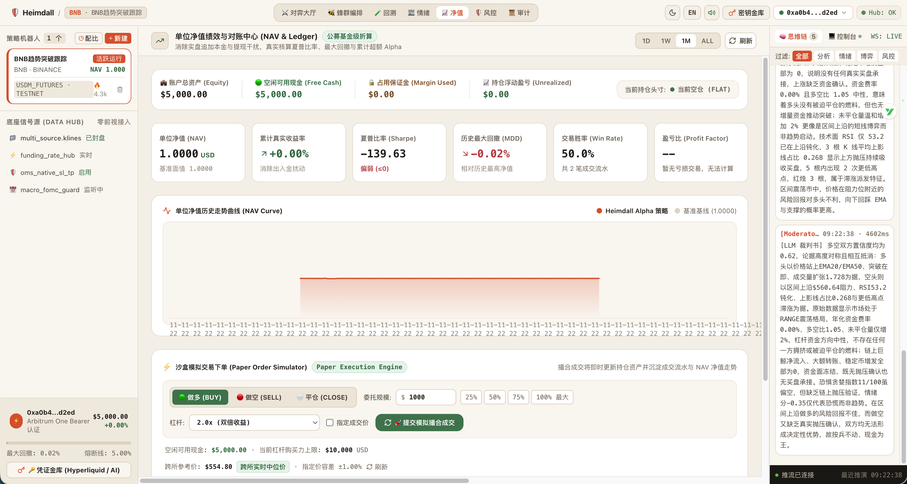

净值页按基金净值的方法核算每个机器人的真实表现。

- **账户概览**：账户总资产、空闲可用现金、占用保证金、持仓浮动盈亏、当前持仓方向。
- **绩效指标**：单位净值（基准 1.0000）、累计真实收益率（已消除出入金影响）、夏普比率、历史最大回撤、交易胜率、盈亏比。
- **净值曲线**：可切换 1 天 / 1 周 / 1 月 / 全部，与基准线对比。
- **沙盒模拟下单**：本地模拟机器人可以手动做多、做空、平仓，按跨所实时中位价成交，成交后即时更新持仓、成交流水和净值。测试网和实盘机器人不在这里手动下单。

### 4.7 风控雷达与对账守卫

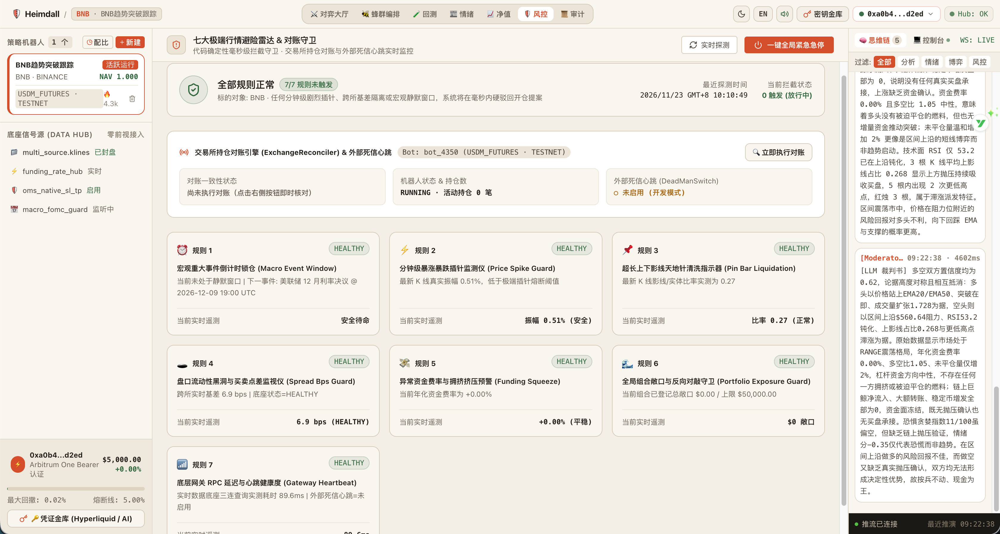

风控页实时展示硬风控规则的状态，并提供交易所对账和全局急停。

**顶部状态**：例如"全部规则正常，7/7 规则未触发"，以及最近探测时间和当前拦截状态。

**交易所持仓对账**：对比机器人记录的持仓与交易所真实持仓，显示对账一致性、机器人状态与持仓数、外部死信心跳状态；"立即执行对账"可手动触发。对账一致后可以选择恢复运行，恢复时会重新做启动前检查并重建决策与对账循环。

**七条硬风控规则**：

| 编号 | 规则 | 检查内容 |
| :---: | :--- | :--- |
| 1 | 宏观重大事件倒计时锁仓（Macro Event Window） | 美联储议息、CPI 等事件前后进入静默期，禁止开新仓；页面显示下一个事件时间。 |
| 2 | 分钟级暴涨暴跌插针监测（Price Spike Guard） | 最新 K 线振幅超过阈值时拦截。 |
| 3 | 超长上下影线插针识别（Pin Bar Liquidation） | 影线与实体比例异常时拦截，防止在插针中追单。 |
| 4 | 盘口流动性与跨所价差监视（Spread Bps Guard） | 跨所价差过大或底座状态不健康时拦截。 |
| 5 | 资金费率与拥挤挤压预警（Funding Squeeze） | 年化资金费率处于极端值时拦截。 |
| 6 | 全局组合敞口守卫（Portfolio Exposure Guard） | 全部机器人已登记的总敞口不得超过上限（截图中为 $50,000）。 |
| 7 | 底层网关延迟与心跳健康度（Gateway Heartbeat） | 数据底座查询耗时与外部心跳异常时拦截。 |

此外，单日回撤达到熔断线（左下账户卡片中显示，截图中为 5.00%）时，机器人会被熔断停止。

**一键全局紧急急停**：先锁定全部机器人，再并发撤销所有在途订单；部分撤单失败时会返回成功、失败和已锁定的机器人清单，并发出最高级别告警。

### 4.8 决策审计

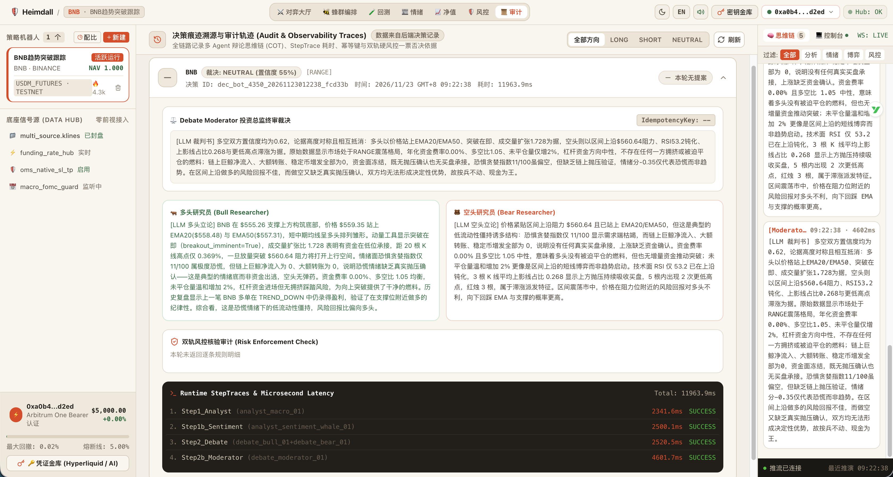

审计页按时间倒序列出每一轮决策，数据来自后端数据库，重启后不会丢失。

- **筛选**：全部方向 / LONG / SHORT / NEUTRAL。
- **每轮记录**：标的、裁决与置信度、市场状态、决策 ID、时间、总耗时、是否生成提案；展开后可看到：
  - 辩论裁判的完整裁决书；
  - 多头研究员与空头研究员的立论原文（左右并排对照）；
  - 双轨风控核验结果（逐条规则明细）；
  - 运行步骤与耗时（例如分析 2341.6ms、情绪 2500.1ms、辩论 2520.5ms、裁决 4601.7ms，合计约 12 秒）。
- **失败轮次**：被拒绝执行或执行出错的轮次也会出现在列表中，并显示失败原因，方便排查"为什么这一轮没有跑"。
- 默认加载最近 50 条。

### 4.9 思维链与控制台

界面右侧常驻两个标签页：

- **思维链**：实时滚动显示各智能体的推演原文，每条带角色、时间和耗时，可按分析 / 情绪 / 博弈 / 风控过滤。
- **控制台**：命令行方式操作当前机器人，支持以下指令：

| 指令 | 作用 |
| :--- | :--- |
| `status` | 查看机器人状态、最近推演时间、结论和推流状态 |
| `step` | 手动触发一轮决策推演 |
| `logs` | 打印最新的大模型决策日志 |
| `risk` | 查看当日回撤、历史回撤、杠杆和风控规则结果 |
| `nav` | 查看最新净值快照 |
| `kill` | 触发全局紧急急停 |
| `clear` | 清屏 |

控制台上方也提供"推演、日志、风控、净值、熔断"快捷按钮。

### 4.10 钱包登录与密钥金库

- **钱包登录**：支持 MetaMask、OKX Web3 Wallet，通过免 Gas 的消息签名换取后端会话；也可以选择只读预览模式，浏览公共机器人和审计数据（写操作和回测需要签名登录）。
- **密钥金库**：集中管理交易所凭证（币安、Hyperliquid 等）和大模型推理密钥。
  - 所有密钥使用 AES-256-GCM 加密存储，并按钱包地址隔离，不同用户之间互相不可见；
  - 交易所凭证可在测试网和正式网之间切换；大模型密钥可设置当前默认使用的那一个；
  - 新增、切换、编辑或删除大模型密钥后立即生效，无需重启；
  - 支持"紧急吊销全部凭据"；
  - 建议使用 Hyperliquid 的 API Agent 派生专用代理私钥，不要填入存有主资产的主钱包私钥。

### 4.11 新建机器人与资金配比

**新建机器人**时依次选择：

| 选项 | 可选值 |
| :--- | :--- |
| 交易标的 | BTC、ETH、SOL、BNB、DOGE、XRP、ADA、AVAX、SUI、LINK、NEAR、APT、ARB、OP、PEPE 等 15 个主流资产 |
| 执行交易所 | 币安（BINANCE） |
| 交易市场 | 现货（不可做空、不支持杠杆）；U 本位合约（多空双向、可加杠杆，自动识别单向 / 双向持仓模式） |
| 运行模式 | 本地模拟（LOCAL_SIM）、测试网（TESTNET）、实盘（MAINNET） |
| 决策策略 | 多空博弈激辩（大模型多智能体）；趋势突破跟踪、动态区间网格（纯算法，不消耗 Token）；资金费率套利（纯算法，仅合约） |
| 初始资金 | 自定义金额（USD） |

选择实盘时会先执行"实盘就绪预检"，预检未通过不能创建。

**资金配比**：查看组合总资金和每个机器人的占比，可单独调整某个机器人的资金。调资时按"新增份额 = 调整金额 ÷ 当前净值"重算份额，净值曲线保持连续；调资不会改变机器人的配置和归属。

---

## 5. 运行模式与安全约定

### 5.1 三种运行模式

| 模式 | 资金 | 下单方式 | 重启后行为 |
| :--- | :--- | :--- | :--- |
| 本地模拟 LOCAL_SIM | 虚拟资金 | 本地撮合，模拟币安标准费率 | 如果重启前在运行，自动恢复调度 |
| 测试网 TESTNET | 交易所测试资金 | 交易所测试网真实下单 | 先注入凭证，再自动恢复调度 |
| 实盘 MAINNET | 真实资金 | 交易所正式网下单 | **不自动恢复**，改为停止状态并发出最高级别告警，需要人工确认后手动启动 |

### 5.2 运行状态的保存与恢复

- 每个机器人的调度状态（是否启用、决策周期、最后更新时间、原因）保存在数据库中。手动启动 / 停止、熔断、急停、暂停都会写回这份记录。
- 后端重启时按记录恢复：重启前在运行的本地模拟和测试网机器人自动继续；没有调度记录的机器人保持停止。
- 查看机器人"最新状态"是只读操作，不会触发决策或下单；只有明确点击"推演"才会跑一轮。

### 5.3 演示机器人

- 平台启动时会自动创建一个演示机器人"ETH 多空激辩对战（演示）"，用于体验产品流程。
- 演示机器人默认停止、只存在于内存、不写入数据库，在侧边栏带"演示"徽章。后端每次重启都会重新创建它，净值、持仓和审计记录从头开始；用户删除后会留下删除记录，之后不再自动创建。

### 5.4 多重保护

- 同一交易账户只允许一个机器人运行，避免多个机器人互相干扰持仓；
- 下单前按交易所规格对齐价格和数量精度；合约只按真实成交数量挂载原生止损止盈；
- 同一个数据库只允许运行一个后端进程，第二个进程会被单实例锁拒绝；
- 支持 Telegram、飞书、Discord 告警推送熔断、成交和异常事件。

---

## 6. 部署与访问

平台由三个容器组成，使用 Docker Compose 部署：

| 容器 | 作用 |
| :--- | :--- |
| `heimdall-web` | Nginx + 前端页面，对内监听 80 端口，把 `/api/`、`/ws/`、`/health` 转发给后端 |
| `heimdall-backend` | FastAPI 后端，监听 8000 端口（单进程） |
| `heimdall-postgres` | PostgreSQL 16 数据库 |

三个容器都不映射宿主机端口，对外访问需要由反向代理加入 `heimdall-network` 后转发到 `heimdall-web:80`。详细的部署、配置与 API 说明见 [README_ZH.md](../README_ZH.md)。

```bash
./deploy.sh up        # 或 docker compose up -d
```

---

## 7. 当前限制

为避免误解，列出当前版本已知的限制：

1. 新建机器人界面目前只开放币安；Hyperliquid 与 OKX 已接入行情和部分执行能力，但尚未接入交易规格自动拉取。
2. 情绪页的实时快讯和链上巨鲸监控需要另行配置数据源，未配置时显示中性，不影响其余功能。
3. 外部死信心跳为可选功能，未配置时风控页显示"未启用"。
4. 升级前产生的历史审计记录没有辩论原文的分步耗时；熔断发生的那一轮不单独记录运行事件。
5. 从旧版本升级后，原本在运行的机器人因为没有调度记录，需要手动点击一次"启动"，之后重启即可自动恢复。
6. 合约双向持仓模式下的部分平仓场景仍在完善中。

---

## 附录 A：智能体角色一览

| 角色 | 中文名 | 职责 | 典型产出 |
| :--- | :--- | :--- | :--- |
| AnalystAgent | 技术面宏观分析师 | 计算 EMA、RSI、ATR、通道高低点，判断市场状态 | `RANGE · 阻力 $560.64`，RSI 53.2 |
| SentimentWhaleAnalyst | 情绪与巨鲸分析师 | 汇总恐慌贪婪指数、资金费率、多空比、链上大额流向 | 情绪分 -0.35，偏空 |
| BullResearcher | 多头先锋研究员 | 寻找上涨证据，给出做多目标价、失效价和置信度 | `LONG · 目标 $572.00 · 防守 $553.50`，62% |
| BearResearcher | 空头研究员 | 识别诱多和阻力抛压，给出做空目标价、失效价和置信度 | `防守 $555.26 · 失效 $562.50` |
| DebateModerator | 多空博弈首席裁判 | 综合双方证据裁决最终方向 | `NEUTRAL`，置信 55% |
| StrategyAgent | 策略智能体 | 根据裁决生成进场价、止损、止盈和仓位 | 观望时"空仓防守 · 暂无挂单" |
| RiskOfficerAgent | 逻辑风控官 | 校验盈亏比和点位逻辑是否自洽 | 通过 / 退回 |
| HardRiskGuard | 代码硬风控 | 七条规则逐条检查，一票否决 | 7/7 通过 / 拦截原因 |

---

## 附录 B：截图索引

| 文件 | 内容 | 所在章节 |
| :--- | :--- | :--- |
| `images/WX20261123-100856@2x.png` | 对弈大厅（主界面） | 3、4.1 |
| `images/WX20261123-100917@2x.png` | 多头研究员详情 | 4.2 |
| `images/WX20261123-100928@2x.png` | 辩论裁判详情 | 4.2 |
| `images/WX20261123-100944@2x.png` | 技术分析师详情 | 4.2 |
| `images/WX20261123-100958@2x.png` | 蜂群编排 | 4.3 |
| `images/WX20261123-101019@2x.png` | 回测实验室 | 4.4 |
| `images/WX20261123-101033@2x.png` | 情绪与链上情报 | 4.5 |
| `images/WX20261123-101046@2x.png` | 净值与对账中心 | 4.6 |
| `images/WX20261123-101057@2x.png` | 风控雷达与对账守卫 | 4.7 |
| `images/WX20261123-101111@2x.png` | 决策审计 | 4.8 |
