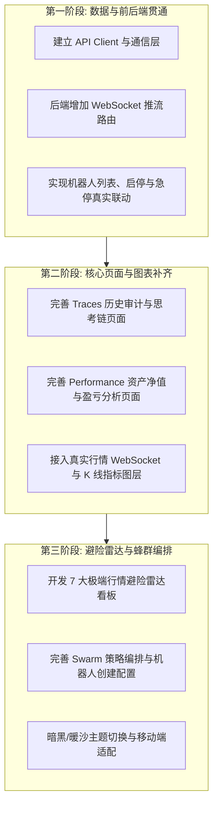

# Heimdall Web 控制台待完善内容与架构落差分析 (Gap Analysis)

> **文档状态**：规划与需求基线 (Draft & Roadmap)  
> **更新时间**：2026-11-19  
> **目标**：在当前确定且被认可的“暖沙复古现代工匠（Cromma 风格）”视觉设计基础之上，梳理出从**纯前端演示原型**演进到**生产级多智能体量化实盘监控平台**所缺失的全部内容、核心模块、数据链路与交互细节。

---

## 总体架构全景（现状 vs 目标）

```mermaid
graph TD
    subgraph Frontend [React 前端架构 (web/)]
        UI[暖沙风格 UI / 德州对弈圆桌]
        Mock[本地静态 Mock 数据 mockData.js] -->|现状: 单机纯模拟| UI
        API_Client[API 客户端 + React Query / SWR] -.->|待建: REST 交互| UI
        WS_Client[WebSocket 客户端 / 实时重连] -.->|待建: 实时推流| UI
        GlobalState[全局状态管理 Zustand] -.->|待建: 跨组件同步| UI
    end

    subgraph Backend [Python 后端架构 (heimdall/)]
        FastAPI[FastAPI 服务端 server.py]
        WS_Hub[WebSocket 推流中枢 /ws/live]
        Scheduler[24H 定时盯盘调度器]
        Pipeline[多智能体决策流水线 Orchestrator]
        RiskGuard[7大极端行情硬风控 Guard]
        DB[(SQLite / PostgreSQL 存储)]
    end

    subgraph Market [外部市场数据源]
        BinanceWS[Binance / OKX 实时 K 线行情]
        MacroCalendar[宏观事件日历 / 恐慌指数]
    end

    API_Client <==>|REST HTTP /api/v1| FastAPI
    WS_Client <==>|双向长链接| WS_Hub
    FastAPI --> DB
    WS_Hub --> Pipeline
    Scheduler --> Pipeline
    Pipeline --> RiskGuard
    BinanceWS --> WS_Client
    MacroCalendar --> RiskGuard
```

---

## 模块缺失与待开发清单

### 一、 数据链路与前后端联调层（P0 基础底座）

| 缺失项 | 现状分析 | 目标要求与实现方案 |
| :--- | :--- | :--- |
| **1.1 REST API 客户端集成** | 前端数据全部写死在 `src/data/mockData.js` 中 | 1. 建立 `src/api/client.js` 与 `src/api/endpoints.js`。<br>2. 对接后端已实现的接口：`/api/v1/bots`（机器人列表）、`/api/v1/bots/{id}/nav`（净值时序）、`/api/v1/bots/{id}/decisions`（决策审计）、`/api/v1/emergency/kill`（紧急关停）。<br>3. 引入全局 Loading、Error 骨架屏与失败重试处理。 |
| **1.2 WebSocket 实时推流中枢** | K 线图依靠前端 `setInterval` 模拟随机跳动，无后端实时事件 | 1. 在 Python 后端新增 `FastAPI WebSocket` 路由 `/ws/stream`。<br>2. 推流内容包括：**即时 K 线行情**、**Agent 多空辩论实时 Token 流**、**风控拦截告警事件**、**订单真实成交通知**。<br>3. 前端实现具备**指数退避自动重连**与**心跳保活**的 `useWebSocket` Hook。 |
| **1.3 全局状态流转 (State Store)** | 各组件（Header, DecisionArena, KlineChart）状态孤立，难以共享 | 引入轻量状态库 `zustand`：<br>1. `useBotStore`：管理当前激活的交易机器人与标的。<br>2. `useArenaStore`：管理当前辩论轮次、出牌状态与选中的 Agent。<br>3. `useRiskStore`：管理全局一键拔网线状态与极端避险信号。 |

---

### 二、 核心视图与页面级功能缺失（P0 ~ P1 核心功能）

#### 2.1 顶部导航栏未实现的页面视图

目前 `Header.jsx` 中点击菜单项仅有占位符或回退到对弈桌面，需补齐各子系统页面：

1. **「蜂群编排 / Swarm Orchestration」页面**
   - **多机器人集群卡片墙**：查看运行中的各策略机器人（ETH 多空对抗型、BTC 趋势跟随型、SOL 剥头皮型）。
   - **创建/配置机器人抽屉**：
     - 选择交易对（BTC/ETH/SOL）、初始分配资金与杠杆倍数（1x ~ 20x）。
     - 选择底层大语言模型驱动源（GPT-4o / Claude 3.5 Sonnet / DeepSeek-V3）。
     - 设定盯盘决策周期（如 1 分钟、5 分钟、15 分钟）。
   - **一键启停/调试单步运行（Step Trigger）**控制面板。

2. **「痕迹溯源 / Audit Traces」页面**
   - **决策历史时间轴（Decision Timeline）**：分页或无限滚动查看历史所有的多智能体对弈记录。
   - **多空辩论详细对比视图**：
     - 展开查看多方代表（Bull）、空方代表（Bear）、中立观察者（Observer）的完整提示词与思考独白（Chain-of-Thought）。
     - 裁判评判过程：量化评分矩阵、最终胜出方案、风控裁决结果（APPROVED 或 REJECTED 及驳回依据）。
   - **快速过滤条件**：按标的、按决策方向（做多/做空/观望）、按风控通过与否过滤。

3. **「资产表现 & 绩效排行榜 / Performance & NAV」页面**
   - **多周期交互式单位净值曲线（NAV Curve）**：
     - 基于真实数据渲染（可支持 Recharts 或 Canvas），支持 1D / 1W / 1M / 1Y / ALL 时间范围切换。
     - 对比基准（如 ETH Buy & Hold 基准收益率曲线叠加）。
   - **量化核心指标面板**：
     - 年化收益率（Annualized Return）
     - 夏普比率（Sharpe Ratio）与索提诺比率（Sortino Ratio）
     - 最大历史回撤（Max Drawdown）与回撤修复期
     - 交易胜率（Win Rate）与多空胜率分布
     - 盈亏比（Profit-Loss Ratio）与平均单笔盈亏
   - **历史成交流水表格（Trade History Table）**：
     - 包含：交易单号、开平仓时间、开仓均价、平仓均价、执行滑点、手续费、实现盈亏。支持导出为 CSV。

4. **「文件与知识库 / Files & RAG」页面**
   - **策略规则与配置编辑器**：在线查看与热修改当前交易策略的参数（如网格间距、止损百分比）。
   - **宏观事件与舆情知识库一览**：
     - 查看采集器抓取的最新加密快讯、RSS 资讯快照、恐惧与贪婪指数历史数据。
     - 向量记忆库（Vector Store / Experience Replay）搜索：查看 Agent 在相似历史行情中的胜败反思记忆。

---

### 三、 实时交易与专业图表能力补齐（P1 专业体验）

#### 3.1 专业 K 线图表（KlineChart）进阶功能
- **交易所真实数据对接**：
  - 直连 Binance 公共 WebSocket（免 API Key 模式获取标准行情），或者通过后端 Bifrost 网关中继。
- **技术指标图层（Technical Indicators）**：
  - 主图指标叠加：EMA(20, 50, 200)、布林带（Bollinger Bands, 20, 2）。
  - 副图指标：成交量（Volume）、MACD、RSI 相对强弱指标。
- **图表盘面交易标记点（Chart Markers）**：
  - 在 K 线蜡烛图上精确打点显示：多头开仓（绿箭头 ↑）、空头开仓（红箭头 ↓）、止损平仓（×）、止盈出场（★）。
  - 动态渲染**当前持仓均价水平线**、**止损触发红虚线**、**目标止盈绿虚线**。

#### 3.2 德州圆桌（DecisionArena）对弈深度交互
- **对弈回放步进器（Debate Stepper）**：
  - 支持“逐轮播放”多智能体讨论：第 1 轮（各自表态）→ 第 2 轮（针对漏洞互相质疑质询）→ 第 3 轮（策略裁决官综合仲裁）→ 第 4 轮（风控官最终硬规则审核）。
- **人工干预协同模式（Human-in-the-Loop）**：
  - 当置信度低于阈值时，圆桌中央提示「需人工二次复核」，操作员可一键同意执行或否决驳回，并可手动微调开仓数量。
- **全局急停按钮（Kill Switch）联动**：
  - 点击左下角「一键急停」时，调出二次红色高危确认弹窗，确认后即刻调用 `/api/v1/emergency/kill` 并播放警报状态动画。

---

### 四、 极端行情风控雷达看板（Extreme Risk Guard Panel）

我们在后端开发了业内领先的 **7 大极端行情硬风控规程**，目前前端尚未有可视化监控入口：

| 风控规则项 | 前端对应可视化表现需求 |
| :--- | :--- |
| **规则 1：宏观重大事件黑天鹅日历避险** | 显示距离下一个 CPI/FOMC 决议的**倒计时时钟**；若进入避险锁定窗口（决议前后 15 分钟），全屏顶栏浮动黄色告警条。 |
| **规则 2：极端分钟级暴涨暴跌插针拦截** | 实时量化柱状条，显示当前标的最近 1 分钟/5 分钟的真实振幅比，超过 2.5% 时高亮闪烁红灯。 |
| **规则 3：上下影线超长“天地针”清洗排查** | 显示当前 K 线的上影线/下影线比例指标，超过 60% 时提示“庄家诱多/清洗流动性中”。 |
| **规则 4：盘口流动性枯竭与买卖点差拉大排查** | 盘口深度监视仪：显示当前买一卖一点差（Spread Bps），超过 15 bps 时显示流动性预警。 |
| **规则 5：异常巨额负资金费率防多头挤压** | 资金费率温度计：显示当前年化费率，当极端低于 -0.1%/8h 时标红预警，提示做空轧空风险。 |
| **规则 6：全市场杠杆爆仓潮链条排查** | 显示 24 小时全网多空爆仓统计图表与短时爆仓热度。 |
| **规则 7：底层网关 RPC 与报价脱节降级保护** | 显示 Bifrost / 交易所心跳延迟（Ping ms）与报价时效性绿/黄/红指示灯。 |

---

### 五、 交互细节与工程化完善（P2 用户体验）

1. **主题模式切换（Theme Switcher）**：
   - 保持当前备受好评的 **暖沙工匠质感（Cromma Light）** 作为默认主题。
   - 补充夜间盯盘专用的 **暗黑量化终端（Midnight Dark）**，适配夜间长时间盯盘对眼睛的舒适度。
2. **通知中枢与声音预警（Audio & Notification Center）**：
   - 接入浏览器 Web Notification API，在后台运行且成交或发生熔断时弹出系统级通知。
   - 关键事件音效反馈（软质打字机声、下单成交提示音、风控警报短鸣）。
3. **移动端与平板端响应式自适应（Responsive Design）**：
   - 当屏幕宽度 `< 1024px` 时，左侧文件栏与右侧终端栏支持手势折叠为浮层抽屉，确保中央圆桌或 K 线图在 iPad/手机端依然可以平滑操作。

---

## 建议实施路线图（Implementation Roadmap）



- **第一阶段（1-2天）**：打通数据通道，用真实 API 替换静态 Mock，实现圆桌启停、下发开仓、一键急停与真实推流；
- **第二阶段（2-3天）**：完善「痕迹溯源（Traces）」与「资产绩效（NAV）」两个核心业务 Tab，升级 K 线图为专业实时指标图；
- **第三阶段（1-2天）**：上线「7大极端行情避险雷达看板」与「蜂群策略编排」，完成暗黑主题与响应式打磨。
